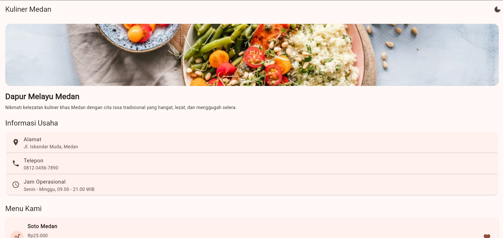
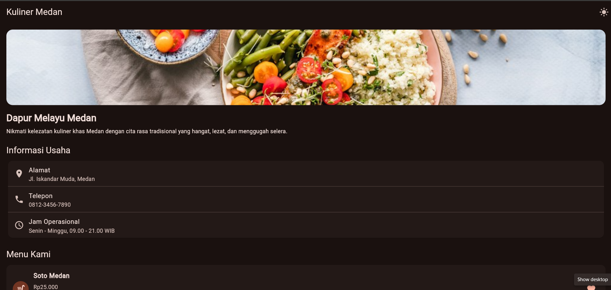

# Tugas Rutin 5 – Indikator Halaman Menu UMKM Kuliner Medan

## A. Identitas Mahasiswa

| Keterangan | Identitas |
|---|---|
| Nama | Yusrida Jelianti Sihite |
| NIM | 4243250048 |
| Kelas | PSIK 24C |
| Mata Kuliah | Pemrograman Mobile |
| Tugas | Tugas Rutin 5 |
| Judul Aplikasi | Dapur Melayu Medan |

## B. Deskripsi Aplikasi

**Dapur Melayu Medan** merupakan aplikasi halaman menu sederhana berbasis Flutter yang menampilkan informasi UMKM kuliner khas Medan. Aplikasi ini menyediakan identitas usaha, deskripsi singkat, informasi kontak, serta daftar makanan dan minuman.

Pengunjung dapat menandai menu sebagai favorit melalui tombol ikon hati. Aplikasi juga menyediakan pilihan tema terang dan gelap menggunakan Material 3.

### Fitur Aplikasi

- Menampilkan gambar, nama, dan deskripsi usaha.
- Menampilkan alamat, nomor telepon, dan jam operasional.
- Menampilkan empat pilihan menu beserta harga dan kategori.
- Menandai dan menghapus menu dari daftar favorit.
- Menampilkan notifikasi SnackBar ketika tombol favorit ditekan.
- Mengubah tampilan antara mode terang dan gelap.

## C. Tangkapan Layar Aplikasi

### 1. Mode Terang (Light Mode)



### 2. Mode Gelap (Dark Mode)



## D. Diagram Widget Tree

Diagram berikut menggambarkan struktur widget yang digunakan dalam aplikasi Dapur Melayu Medan.

```text
MaterialApp
│
├── AplikasiUMKM (StatefulWidget)
│   │
│   └── HalamanUMKM (StatelessWidget)
│       │
│       └── Scaffold
│           │
│           ├── AppBar
│           │   └── IconButton (Ubah Tema)
│           │
│           └── SingleChildScrollView
│               │
│               └── Column
│                   │
│                   ├── HeaderUMKM (StatelessWidget)
│                   │   ├── Image
│                   │   └── Text
│                   │
│                   ├── InfoKontak (StatelessWidget)
│                   │   └── Card
│                   │       └── ListTile
│                   │           ├── Alamat
│                   │           ├── Telepon
│                   │           └── Jam Operasional
│                   │
│                   └── DaftarMenu (StatelessWidget)
│                       │
│                       ├── KartuMenu (StatelessWidget)
│                       │   └── TombolFavorit (StatefulWidget)
│                       │
│                       ├── KartuMenu (StatelessWidget)
│                       │   └── TombolFavorit (StatefulWidget)
│                       │
│                       ├── KartuMenu (StatelessWidget)
│                       │   └── TombolFavorit (StatefulWidget)
│                       │
│                       └── KartuMenu (StatelessWidget)
│                           └── TombolFavorit (StatefulWidget)
```

**Keterangan:**

- **StatefulWidget:** AplikasiUMKM dan TombolFavorit karena memiliki state yang dapat berubah.
- **StatelessWidget:** HalamanUMKM, HeaderUMKM, InfoKontak, DaftarMenu, dan KartuMenu karena berfungsi menampilkan data tanpa mengelola state internal.

## E. Penjelasan Arsitektur Flutter

Widget tree merupakan struktur hierarki yang menggambarkan hubungan antarwidget dalam aplikasi Flutter. Setiap widget memiliki peran dalam membentuk tampilan, mulai dari MaterialApp sebagai akar aplikasi hingga komponen kecil seperti Text, IconButton, dan Card. Pada aplikasi Dapur Melayu Medan, widget tree membantu menyusun halaman menjadi beberapa bagian sehingga kode lebih terorganisasi dan mudah dipahami.

Element tree merupakan representasi dari widget tree yang mengelola hubungan antara widget dengan objek yang dipertahankan selama proses pembangunan ulang tampilan. Element membantu Flutter mengetahui bagian mana yang perlu diperbarui ketika terjadi perubahan state, sehingga tidak semua elemen harus dibuat ulang.

Render tree bertanggung jawab mengatur proses layout dan menggambar tampilan ke layar. Render object menentukan ukuran, posisi, dan cara setiap komponen ditampilkan.

Pemilihan StatelessWidget diterapkan pada HeaderUMKM, InfoKontak, DaftarMenu, KartuMenu, dan HalamanUMKM karena komponen tersebut hanya menampilkan data. Sementara itu, StatefulWidget digunakan pada AplikasiUMKM untuk mengatur pergantian tema serta TombolFavorit untuk mengubah status ikon hati. Dengan pemisahan ini, pengelolaan state menjadi lebih terarah dan struktur aplikasi lebih mudah dipelihara.

## F. Pengujian Aplikasi

Pengujian dilakukan menggunakan perintah berikut:

```bash
flutter analyze
flutter test
```

Pengujian widget dilakukan untuk memastikan tombol favorit dapat mengubah ikon dari `favorite_border` menjadi `favorite` setelah ditekan dan menampilkan SnackBar.

## G. Pernyataan Penggunaan AI

Dalam pengerjaan tugas ini, AI digunakan sebagai alat bantu untuk memahami struktur widget Flutter, memberikan referensi penulisan kode, serta membantu penyusunan dokumentasi README.md. Implementasi, penyesuaian, dan pengujian aplikasi dilakukan serta diperiksa kembali oleh mahasiswa.

---

**Repository:** `pm-tugas-05-4243250048`

**Teknologi:** Flutter, Dart, Material 5
